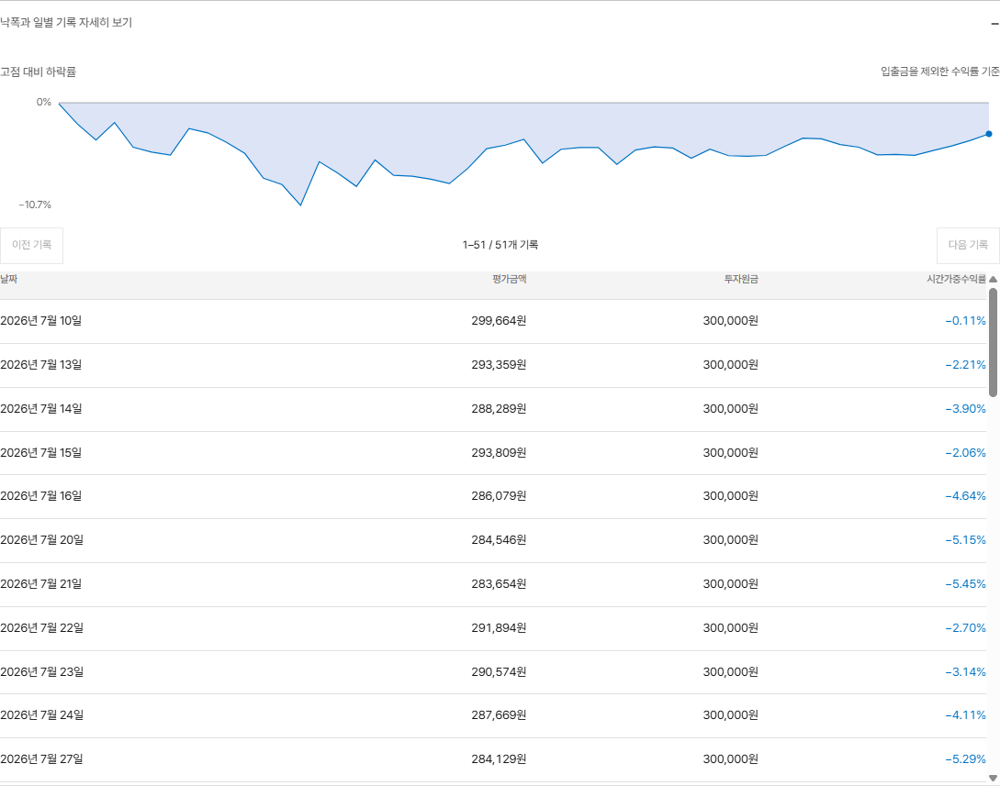

# 계좌 화면 사용법

[설치 안내](GETTING_STARTED.md) · [README](../README.md)

## 계좌 선택

화면 위쪽에서 **ETF 적립** 또는 **대형주 분산 투자**를 누릅니다. 선택한 계좌에 맞춰 금액, 수익률 차트, 보유 종목이 바뀝니다.

처음 설치했다면 아직 거래 기록이 없습니다. [모의투자 실행 방법](GETTING_STARTED.md#모의투자)에 따라 한 번 실행한 뒤 화면을 새로고침하세요. 주문 조건에 맞지 않으면 거래가 없을 수도 있습니다.

## 수익률

차트 아래의 날짜 막대를 움직이면 그날의 금액과 수익률이 나옵니다. **최근 날짜**를 누르면 마지막 기록으로 돌아갑니다.

- **투자원금**: 처음 넣은 돈과 나중에 추가한 돈입니다.
- **평가금액**: 보유 주식·ETF의 금액과 현금을 합한 금액입니다.
- **수익률**: 돈을 넣고 뺀 영향을 제외한 투자 수익률입니다.

입금은 수익으로 계산하지 않습니다. 수익률 계산 방식은 흔히 쓰는 이름으로 **시간가중수익률(TWR)**이라고 합니다.

**입체**와 **평면**은 같은 수익률을 다른 모양으로 보여 줍니다. 입체 차트의 띠 너비가 별도의 투자 지표를 뜻하지는 않습니다.

날짜와 시각은 모두 한국 시간 기준입니다. 해외에서 접속해도 거래 날짜와 월별 수익률은 같습니다.

**낙폭과 일별 기록 자세히 보기**를 열면 날짜별 금액이 표로 나옵니다. 기록이 많으면 100개씩 나눠 보여 줍니다. **이전 기록**, **다음 기록**으로 넘길 수 있고, CSV에는 조회 기간의 모든 기록이 담깁니다.

[계좌 화면 크게 보기](images/readme-account-20260922.png)

## 내역 저장

차트 아래 **기록 내려받기**를 누르면 CSV 파일이 저장됩니다. 선택한 계좌와 기간에 해당하는 날짜, 평가금액, 투자원금, 수익률, 고점 대비 하락률이 들어 있습니다. 엑셀에서도 열 수 있습니다.

## 보유 종목

종목마다 보유 수량, 평균 매수가, 매수한 금액, 비중이 나옵니다. 지금 비중과 목표 비중을 나란히 비교할 수 있습니다.

이 표의 비중은 저장된 **평가 시점의 시장가격 기준**입니다. 가격이나 보유 수량이 맞지 않으면 미확인으로 표시합니다. 목표와의 차이, 최소 1주 수량 등 주문을 보류한 이유도 확인할 수 있습니다.

[보유 종목 화면 크게 보기](images/readme-holdings-20260922.png)

## 시장 관찰

상단 **시장 관찰**에서 바스켓 구성 종목과 업종 ETF를 비교합니다. **시장 자료 갱신**을 누르면 공개 가격을 새로 수집합니다. 최대 2분 정도 걸릴 수 있으며 화면을 열어 두기만 하면 저장 자료를 읽습니다.

- **관찰 대상**에서 업종 ETF 또는 바스켓 구성 종목을 고릅니다. 바스켓 설정에 있다는 표시는 실제 보유를 뜻하지 않습니다.
- **상대 강도 정렬**은 20·60·120거래일 중 고른 기간의 KODEX 200 대비 수익률 차이입니다. +5는 비교지수보다 5%p 높았다는 뜻입니다.
- **60일 평균선 위**는 확인 가능한 관찰 종목 중의 비율이며 전체 시장의 상승 종목 비율이 아닙니다.
- **거래량 배수**는 직전 거래일 거래량을 그 이전 20일 평균과 비교합니다. 변동성은 최근 20일 수익률의 연율화 표준편차입니다.

당일 봉은 사용하지 않습니다. 수집 시각과 종가 기준일을 따로 확인하세요. 지연·누락·가격 기준 미확인 자료는 순위에서 제외합니다. 공급자의 배당 조정 방식은 다를 수 있으며 수수료·세금·실제 체결 비용을 반영한 수익률이 아닙니다.

아래 **검토 중인 투자 가설**에는 사람이 원문을 확인해 등록한 가설과 반증 조건, 출처, 검토일이 나옵니다. `확인 부족`은 공개 시각 등 근거가 불충분하다는 뜻이며, `검토 중`도 가설이 입증됐다는 뜻은 아닙니다. 지나간 기업 이벤트는 결과 검토 대상으로 바뀝니다.

관찰 순위와 투자 가설은 자동 주문을 만들지 않습니다. 등록·재현 방법과 조사 출처는 [전문 운용 조사 보고서](INVESTMENT_RESEARCH_20261013.md)를 참고하세요.

아래 **공시·수급 자동 수집**은 일일 운영 뒤의 수집 상태와 최근 원문을 보여줍니다. 수급은 NAVER 제공 종목별 순매수 수량(주)입니다. DART 인증 오류가 있으면 `.env`의 유효한 키 설정이 필요하며, 공시가 없는 날과 수집 실패를 구분해서 표시합니다.

**장기 모의운용 검증**의 종가 기록 상태도 확인하세요. 오전 자산 스냅샷만으로는 종가 성과가 누적되지 않습니다. `tools/daily_observation.py`는 장마감 이후 종가 평가를 기록한 다음 자료 수집·성과 검증을 실행합니다. 장전·장중에는 직전 완료 거래일의 종가 유무만 확인하며, 빠진 과거 종가를 현재 보유량으로 만들어 채우지 않습니다. 수급·레이더는 당일 잠정 값을 제외하므로 다음 날 아침 수집으로 직전 거래일까지 확인합니다. [실제 일일 운영 연결과 점검 명령](RESEARCH_OPERATIONS_20261013.md#실제-일일-운영-연결-후속-점검)

**체결비용 관측**의 양수는 기준가격보다 불리한 체결입니다. 모의 체결·증권사 환경·수수료 추정 여부를 함께 확인하세요. **장기 모의운용 검증**은 등록 이후 자료만 누적하며 기본 표본 요건은 120거래일 수익률, 180일 기간, 상승/하락 각각 20일입니다. 표본 요건 충족은 수익성 합격 판정이 아닙니다. [실행과 검증 기준](RESEARCH_OPERATIONS_20261013.md)

## 적립금 기록

모의투자에 쓸 가상 자금을 추가하는 기능입니다.

1. 화면 위쪽의 **적립금 기록**을 누릅니다.
2. 계좌를 고르고 금액을 입력합니다. 필요하면 메모도 남깁니다.
3. **내용 확인**을 누른 뒤 계좌, 금액, 모의투자 여부를 다시 확인하고 기록합니다.

은행에서 돈을 가져오거나 자동이체를 등록하는 기능은 아닙니다. 추가한 금액은 모의투자 원금에 더해집니다.

## 매매 설정

기본으로 사용하는 설정은 두 가지입니다.

- **ETF 적립**: KODEX 200과 TIGER CD금리 ETF에 나눠 투자합니다. 시작 금액은 30만원, 월 적립 계획은 10만원입니다. 추가 투자금은 직접 기록합니다.
- **대형주 분산 투자**: 국내 대형주에 나눠 투자합니다. 주식 60%·현금 40%를 목표로 하며, 비중 차이가 커지면 조정합니다.

종목과 비중은 [config/baskets.yaml](../config/baskets.yaml)에서 바꿉니다. 설정 파일의 `kr_pocket`은 ETF 적립, `kr_diversified_hold`는 대형주 분산 투자입니다.

ETF 적립 설정은 현재 모의투자 전용입니다. 1주 가격과 최소 주문금액 때문에 실제 매수 비중이 목표와 다를 수 있습니다. CD금리 ETF도 원금을 보장하지 않습니다.

## 자동매매 상태

**자동매매 상태**에는 마지막 실행 시각, 거래 중지 여부, 증권사 연결과 데이터 갱신 상태가 나옵니다. 오류가 표시되면 **다시 확인**을 눌러 상태를 새로 불러옵니다.

자동매매는 계좌 화면과 별도로 실행합니다. 계속 매매하려면 PC와 자동매매 프로그램을 켜 두어야 합니다. 화면만 열어 놓아서는 매매가 시작되지 않습니다.

- [자동 실행 설정](PROJECT_GUIDE.md)
- [거래가 중지됐을 때 확인할 것](SAFETY_MODEL.md)
- [실제 계좌 연결과 주문 설정](PAPER_TO_LIVE_RUNBOOK.md)

## 모바일 접속

화면은 휴대폰 크기에 맞춰 바뀝니다. 차트의 날짜도 터치로 고를 수 있습니다.

기본 주소 `127.0.0.1`은 프로그램을 실행한 PC에서만 열립니다. 휴대폰에서 접속하려면 접속 주소와 인증을 별도로 설정해야 합니다. [연결 설정](PROJECT_GUIDE.md)을 참고하세요.

## 문의

[오류 제보·기능 제안](https://github.com/easygap/quant_trader/issues/new/choose)에 문제가 생긴 상황과 화면을 남겨 주세요. 계좌번호, API 키, 비밀번호는 지우고 올려 주세요.
